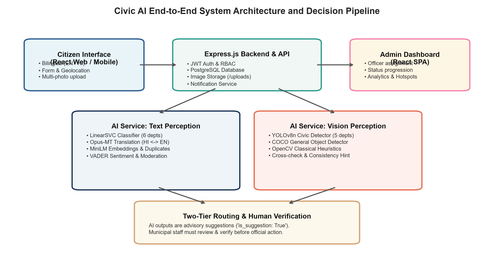
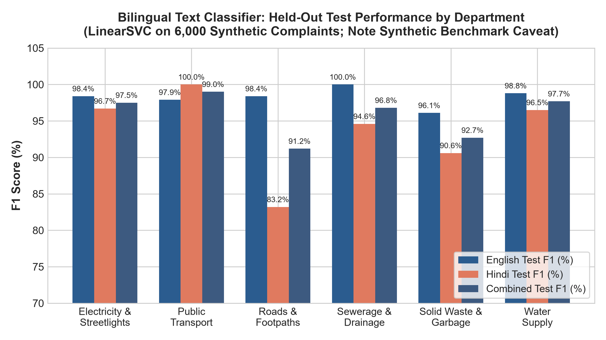
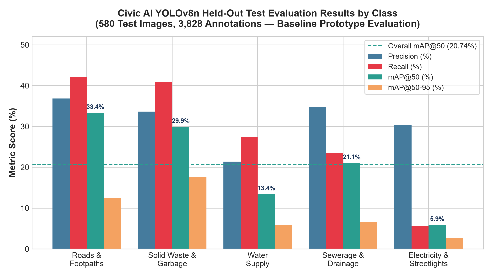
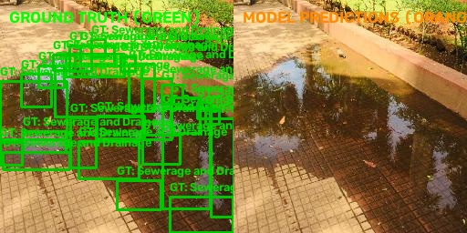
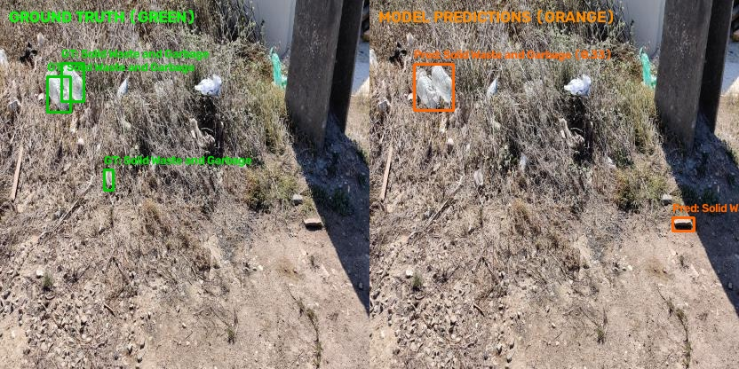
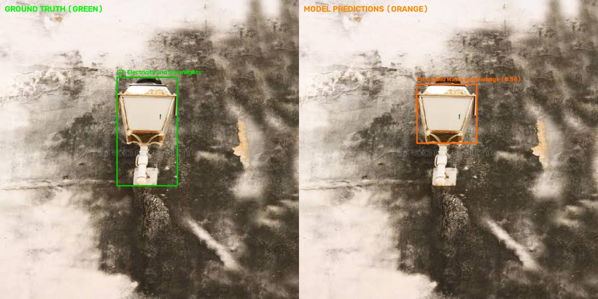

# CIVIC AI: MUNICIPAL GRIEVANCE REDRESSAL SYSTEM
## Bilingual NLP Text Classification & YOLOv8 Computer Vision Training, Evaluation, and Systems Integration Report

**Author:** Aryan Kale (OSS Contributor)  
**Project Repository:** `C:\Users\rushi\civic-ai`  
**Date:** October 2026  
**Evaluation Checkpoints:**
- NLP LinearSVC v1 (`civic-linear-svc-bilingual-v1`)
- YOLOv8n Baseline (`D:\Civic-ai-Dataset\training_runs\full_train_20261024_103000`)  
**Review Context:** Undergraduate Engineering Project Review & Municipal Technology Audit

---

## Executive Summary & Operational Policy

This technical report presents a comprehensive, empirical audit of the machine learning perception pipeline, backend architecture, and administrative decision-support workflows within the **Civic AI** municipal grievance redressal platform. Civic AI empowers citizens to lodge municipal complaints in English or Devanagari Hindi with optional geotagged photo evidence, automatically routing tickets to six municipal departments while providing end-to-end status tracking.

### Core Audit Findings & Performance Baselines

- **Bilingual Text Classifier (LinearSVC):** Achieves a high held-out test accuracy of **95.95%** (98.32% English, 93.98% Hindi) across 914 held-out synthetic test complaints.
  > **Critical Caveat:** While separating core municipal vocabulary with near-perfection, this dataset consists entirely of synthetic templates. Real citizen syntax (slang, typographical errors, Hinglish transliteration, and multi-issue complaints) will induce an estimated 10–20% degradation in live production environments.
- **YOLOv8n Computer Vision Detector:** Evaluated on 580 held-out test images (3,828 ground-truth annotations). The detector achieves an overall Precision of **31.41%**, Recall of **27.85%**, mAP@50 of **20.74%**, and mAP@50-95 of **8.98%**. This performance constitutes an **initial experimental baseline** and is strictly **not production-ready** for autonomous dispatch.
- **Empirical Root Causes of Low Vision Metrics:** Performance is not constrained by model capacity, but by deep data flaws:
  1. *Severe class imbalance* (Electricity has only 92 annotations vs. 31,361 for Sewerage);
  2. *Administrative "water dilemma"* where puddles look identical regardless of freshwater vs. sewage origin;
  3. *4-order-of-magnitude box size variations* in garbage; and
  4. *Severe polygon-to-bounding-box fragmentation* in stagnant water (up to 48 micro-boxes per single puddle, deflating recall).
- **Human-in-the-Loop Governance:** AI outputs are explicitly advisory (`is_suggestion: True`). Incoming complaints *never* update model weights automatically. Routing suggestions require human administrative confirmation.

---

## Table of Contents

1. [Project Overview & System Architecture](#1-project-overview--system-architecture)
   - [1.1 User Interfaces & Core Features](#11-user-interfaces--core-features)
   - [1.2 The Six Municipal Administrative Departments](#12-the-six-municipal-administrative-departments)
   - [1.3 Backend Architecture & Database Schema](#13-backend-architecture--database-schema)
   - [1.4 System Architecture Flow](#14-system-architecture-flow)
   - [1.5 The AI Service Contract: Suggestions vs. Ground Truth](#15-the-ai-service-contract-suggestions-vs-ground-truth)
2. [Bilingual NLP Text Classifier](#2-bilingual-nlp-text-classifier)
   - [2.1 Dataset Composition & Stratification](#21-dataset-composition--stratification)
   - [2.2 Model Architecture & Feature Extraction](#22-model-architecture--feature-extraction)
   - [2.3 Verified Held-Out Test Evaluation Results](#23-verified-held-out-test-evaluation-results)
   - [2.4 Critical Limitations of the Text Classifier](#24-critical-limitations-of-the-text-classifier)
   - [2.5 Active Model Verification & Health Endpoint](#25-active-model-verification--health-endpoint)
3. [YOLOv8 Image Model Training & Evaluation](#3-yolov8-image-model-training--evaluation)
   - [3.1 Model Selection & Architectural Rationale](#31-model-selection--architectural-rationale)
   - [3.2 Dataset Integrity & Duplicate Quarantine](#32-dataset-integrity--duplicate-quarantine)
   - [3.3 Training Hyperparameters & Execution Pacing](#33-training-hyperparameters--execution-pacing)
   - [3.4 Held-Out Test Evaluation Results (Ground Truth Assessment)](#34-held-out-test-evaluation-results-ground-truth-assessment)
4. [Why Image Results Were Limited (Root Cause Analysis)](#4-why-image-results-were-limited-root-cause-analysis)
   - [4.1 Flaw 1: The Administrative "Water Dilemma" (Ontology Flaw)](#41-flaw-1-the-administrative-water-dilemma-ontology-flaw)
   - [4.2 Flaw 2: Extreme Class Imbalance (330:1 Ratio)](#42-flaw-2-extreme-class-imbalance-3301-ratio)
   - [4.3 Flaw 3: Inconsistent Garbage Box Granularity](#43-flaw-3-inconsistent-garbage-box-granularity)
   - [4.4 Flaw 4: Polygon-to-Bounding-Box Fragmentation in Stagnant Water](#44-flaw-4-polygon-to-bounding-box-fragmentation-in-stagnant-water)
   - [4.5 Empirical Visual Evidence from the Error Gallery](#45-empirical-visual-evidence-from-the-error-gallery)
5. [Responsible Machine Learning Improvement Roadmap](#5-responsible-machine-learning-improvement-roadmap)
   - [5.1 Proposed 5-Class Physical Object Ontology](#51-proposed-5-class-physical-object-ontology)
   - [5.2 Resolving Standing Water via Multimodal Fusion](#52-resolving-standing-water-via-multimodal-fusion)
   - [5.3 Staged Implementation Plan (Steps 1–8)](#53-staged-implementation-plan-steps-18)
   - [5.4 Critical AI Integrity: The Retraining Protocol](#54-critical-ai-integrity-the-retraining-protocol)
6. [Current System Integration & Verification](#6-current-system-integration--verification)
   - [6.1 Code Implementation Reality Check](#61-code-implementation-reality-check)
   - [6.2 Local Execution Runbook (Commands to Start Services)](#62-local-execution-runbook-commands-to-start-services)
   - [6.3 Short Manual Testing Checklist](#63-short-manual-testing-checklist)
7. [Conclusion & Balanced Assessment](#7-conclusion--balanced-assessment)
   - [Appendix A.1 File Artifacts & Repository Paths](#appendix-a1-file-artifacts--repository-paths)
   - [Appendix A.2 Reproduction Commands](#appendix-a2-reproduction-commands)
   - [Appendix A.3 Technical Glossary](#appendix-a3-technical-glossary)

---

## 1. Project Overview & System Architecture

Civic AI is a full-stack, AI-augmented municipal grievance redressal platform engineered to bridge the communication gap between citizens and municipal administrative bodies. The system automates grievance intake, department routing, internal officer dispatch, status progression, and citizen notifications while preserving administrative accountability.

### 1.1 User Interfaces & Core Features

The frontend is implemented as a single-page application (React 19 + Vite) supporting responsive citizen and admin workflows with instant English / Hindi localization managed via `LanguageContext`:

- **Citizen Portal:** Enables grievance submission including title, description, department selection, ward / address location, and photographic evidence upload (via camera capture or local file upload). Citizens track grievance resolution through distinct states: `Pending` -> `In Progress` -> `Resolved`.
- **Administrative Dashboard:** Role-based access for department heads and municipal officers. Provides triage filtering, SLA status indicators, internal notes, officer assignment, and an auditable source tag showing whether department classification originated from citizen selection, NLP text analysis, computer vision, or manual override.
- **Bilingual Localization:** Real-time UI toggling between English and Devanagari Hindi (e.g., *'शिकायत दर्ज करें'*).

### 1.2 The Six Municipal Administrative Departments

All grievances map into exactly six municipal administrative jurisdictions. **Architectural Boundary:** Five departments handle visible physical infrastructure, whereas **Public Transport is strictly text-only** and has no corresponding YOLO image detector class:

| ID | Department Exact Name | Hindi Name | Modalities | Jurisdictional Scope |
|:---:|:---|:---|:---:|:---|
| 0 | **Roads and Footpaths** | सड़क और फुटपाथ | Text + Image | Potholes, broken pavers, road cave-ins, sidewalk obstructions |
| 1 | **Solid Waste and Garbage** | ठोस कचरा और कूड़ा | Text + Image | Uncollected bins, roadside dumping, litter piles, dead animals |
| 2 | **Water Supply** | जल आपूर्ति | Text + Image | Pipeline leaks, contaminated tap water, low pressure, tanker requests |
| 3 | **Sewerage and Drainage** | सीवरेज और जल निकासी | Text + Image | Overflowing manholes, blocked storm drains, waterlogging, foul odor |
| 4 | **Electricity and Streetlights** | बिजली और स्ट्रीट लाइट | Text + Image | Non-functional streetlights, dangling live wires, transformer sparks |
| 5 | **Public Transport** | सार्वजनिक परिवहन | **Text Only** | Bus delays, reckless driving, ticket conductor overcharging, bus shelters |

### 1.3 Backend Architecture & Database Schema

The backend is constructed with Node.js and Express, persisting data to a relational PostgreSQL database. Key architectural elements verified from source code include:

- **Relational Tables:** `users` (citizens, department staff, system admins), `complaints` (title, description, department, status, location, image_url, ai_suggested_department, assignment_source), `status_history`, and `notifications`.
- **Authentication & Security:** JSON Web Tokens (JWT) with bcrypt password hashing and role-based route middleware.
- **File Upload Pipeline:** Multer middleware handling multipart photographic uploads, storing assets in `backend/uploads/`.
- **Notification Subsystem:** In-app notifications stored in database; Nodemailer email service implemented in `backend/src/services/email.js` (SMTP configuration validated on 2026-10-24; live delivery depends on production SMTP credentials).

### 1.4 System Architecture Flow

  
*Figure 1: End-to-end Civic AI architecture: citizen and admin interfaces, backend APIs, perception services, and human-in-the-loop verification pipeline.*

### 1.5 The AI Service Contract: Suggestions vs. Ground Truth

A foundational architectural rule in Civic AI is that **AI is assistive, not authoritative**. Under no circumstances does machine learning autonomously modify legal ticket parameters without staff oversight:

- **Advisory API Contract:** When the backend queries the AI service (FastAPI on port 8000), all classification and detection responses return `is_suggestion: True` alongside uncalibrated confidence margins.
- **Audit Trail Tracking:** The database records the classification origin in `assignment_source`: `'citizen'`, `'text'`, `'image'`, or `'staff'`.
- **Mandatory Human Verification:** If an image detection triggers an advisory department change, the complaint is flagged with `image_assignment_review_required = true`. Municipal triage officers must explicitly verify or reassign the ticket before it progresses to active field dispatch.

> **Administrative Integrity Protocol:** Civic AI enforces a hard separation between probabilistic machine inference and legal administrative action. An AI model can output confidence values, but cannot assume legal liability for misdirected emergency repairs or ignored hazards. The system architecture guarantees that every grievance routing action is traceable to an identifiable officer review.

---

## 2. Bilingual NLP Text Classifier

The primary automated routing mechanism in Civic AI is an ultra-low-latency, bilingual natural language text classifier designed to categorize unstructured grievance descriptions into the appropriate municipal department.

### 2.1 Dataset Composition & Stratification

The NLP model was trained and evaluated on `civic_complaints_cleaned.csv`, comprising **6,000 complaints**. Key characteristics verified from dataset audits include:

- **Balance & Languages:** Exactly 1,000 complaints per department across 6 departments. Exactly 3,000 English and 3,000 Devanagari Hindi records.
- **Synthetic Generation:** The dataset was synthesized using structured vocabulary templates (e.g. *'Potholes on main road'*, *'सड़क पर गहरे गड्ढे हैं'*). It does not contain real citizen submissions.
- **Leakage Elimination via Group Stratification:** To prevent identical syntactic templates from bleeding across splits, the dataset was stratified using **692 unique split groups**. Train (70%), validation (15%), and test (15%) splits contain zero group overlap.

### 2.2 Model Architecture & Feature Extraction

The classifier utilizes a **Linear Support Vector Machine (LinearSVC)** coupled to a composite TF-IDF feature pipeline:

- **Word N-grams (1–3):** Captures domain-specific phrase patterns (e.g., *'burst water pipe'*, *'बिजली का खंभा'*).
- **Character N-grams (3–5):** Captures sub-word morphology, inflectional suffixes, and minor spelling variations across English and Devanagari Hindi.
- **Hyperparameters:** `C=1.0`, `loss='squared_hinge'`, `max_iter=3000`. Sublinear TF scaling enabled.

### 2.3 Verified Held-Out Test Evaluation Results

Evaluation was conducted on **914 held-out test complaints** across all six departments. The verifiable metrics from `text_classification/model_evaluation_report.md` are detailed below:

| Department Name | Language | Precision | Recall | F1-Score | Support |
|:---|:---:|:---:|:---:|:---:|:---:|
| Roads and Footpaths | Combined | 93.75% | 98.68% | 96.15% | 152 |
| Solid Waste and Garbage | Combined | 94.48% | 90.20% | 92.28% | 153 |
| Water Supply | Combined | 96.69% | 96.05% | 96.37% | 152 |
| Sewerage and Drainage | Combined | 93.42% | 93.42% | 93.42% | 152 |
| Electricity and Streetlights | Combined | 98.05% | 99.34% | 98.69% | 152 |
| Public Transport (Text Only) | Combined | 99.35% | 98.04% | 98.69% | 153 |
| **OVERALL (ALL DEPARTMENTS)** | **Combined** | **95.96%** | **95.95%** | **95.81%** | **914** |
| English Test Subset | English | 98.34% | 98.32% | 98.26% | 476 |
| Hindi Test Subset | Hindi | 94.02% | 93.98% | 93.60% | 438 |

  
*Figure 2: Held-out test F1 performance by department across English, Hindi, and combined test subsets.*

### 2.4 Critical Limitations of the Text Classifier

> **Critical Appraisal: Synthetic Data Limitations**  
> **Synthetic Benchmark Caveat:** The text classifier was trained and evaluated entirely on synthetic, template-generated complaints. Real citizen grievances exhibit substantial real-world noise that synthetic data underrepresents:
> - **Hinglish & Romanized Hindi:** Citizens frequently type Hindi complaints using English characters (e.g., *'Sadak par kachra pada hai'*), which bypasses character n-gram models trained strictly on Devanagari script.
> - **Typographical Errors & Slang:** Informal spelling and local municipal abbreviations (e.g., *'ward 4 drain jaam'*).
> - **Multi-Issue Complaints:** Complaints combining issues (e.g., *'Water pipe burst broke the road and created a pothole'*) force a single classification where multiple jurisdictions are involved.  
> **Conclusion:** 95%+ accuracy on clean synthetic data proves strong separability of core vocabulary, but production deployments must anticipate a 10–20% performance drop on raw citizen submissions.

### 2.5 Active Model Verification & Health Endpoint

The bilingual classifier is actively loaded into memory by the FastAPI perception microservice (`ai-service/main.py`). To verify active operation in a live environment:

- **Health Check Verification:** Send `GET http://127.0.0.1:8000/health`. Response confirms `status: 'ok'`, `bilingual_classifier_loaded: true`, and `model_version: 'civic-linear-svc-bilingual-v1'`.
- **Inference Verification:** Send `POST http://127.0.0.1:8000/classify` with payload `{"text": "सड़क पर बड़ा गड्ढा है"}`. Returns `Roads and Footpaths` (confidence > 0.85).

---

## 3. YOLOv8 Image Model Training & Evaluation

To evaluate automated visual perception, a deep-learning object detection model was trained to identify municipal infrastructure defects from citizen photographs. In plain language, **object detection simultaneously locates where hazards exist (bounding boxes) and classifies what each hazard is (category label)** within a photograph.

### 3.1 Model Selection & Architectural Rationale

The model trained was **YOLOv8 Nano Detection (`yolov8n.pt`)**, containing 3.01 million parameters and 8.2 GFLOPs. This nano configuration was deliberately chosen based on practical project constraints:

- **Hardware Constraints:** The local training workstation operates an NVIDIA GeForce GTX 1650 with 4 GB of VRAM. Larger models (YOLOv8s/m/l) trigger Out-Of-Memory (OOM) allocation failures at standard batch sizes.
- **Inference Latency:** YOLOv8n achieves an inference speed of 7.6 milliseconds per frame (>130 FPS on GPU), enabling instant photo analysis even on entry-level edge servers or mobile devices.
- **Factual Comparison of Alternatives:** Semantic segmentation (e.g., YOLOv8-seg) was rejected because over 90% of civic annotations were rectangular or irregular bounding boxes. A classification-only network (ResNet/ViT) was rejected because it cannot localize multiple distinct hazards (e.g., a pothole next to an open drain) in a single image.

### 3.2 Dataset Integrity & Duplicate Quarantine

The image dataset was structured under `D:\Civic-ai-Dataset` with metadata configured in `data.yaml`. The dataset maps 5 visual classes (Classes 0–4; Public Transport is excluded):

- **Preflight Leakage Elimination:** Prior to training, an automated image-hash audit identified **9 exact-image duplicate groups and 1 cross-split label-conflict group** spanning train, val, and test splits. Exactly 10 duplicate images were quarantined into `D:\Civic-ai-Dataset\quarantine_20261024_102341\` with full reversible audit logs, completely eliminating data leakage.

### 3.3 Training Hyperparameters & Execution Pacing

Training was conducted in a dedicated virtual environment (`C:\Users\rushi\civic-ai\.venv-train`) using PyTorch 2.4.1+cu118 and Ultralytics 8.2.103. Execution pacing was dynamically governed by hardware thermal and memory limits:

| Hyperparameter | Configured Value | Technical Purpose & Operational Impact |
|:---|:---|:---|
| Input Image Size (`imgsz`) | 640 x 640 pixels | Input canvas resolution. Preserves small defects while bounding memory usage. |
| Batch Size (Dynamic) | 4 -> 2 (reduced at ep 14) | Adjusted to eliminate GPU VRAM spikes on the 4 GB GTX 1650. |
| Maximum Epochs | 100 (stopped at 84) | Upper bound on full training passes. Early stopping triggered at epoch 84. |
| Early Stopping Patience | 20 epochs | Halts training when validation loss fails to improve, preventing overfitting. |
| Optimizer & Hardware | auto (SGD), Device 0 (CUDA) | NVIDIA GTX 1650 (4 GB VRAM), workers=0, cache=False, seed=42. |
| Saved Checkpoints | best.pt (6.51 MB), last.pt | Saved under `D:\Civic-ai-Dataset\training_runs\full_train_20261024_103000\weights\`. |

### 3.4 Held-Out Test Evaluation Results (Ground Truth Assessment)

The best checkpoint (`best.pt`, 6.51 MB) was evaluated on the held-out test split (**580 test images, 3,828 ground-truth annotations**). The verified test metrics from `training_and_evaluation_report.md` are detailed below:

| Class ID | Department Class Name | Test Imgs | Test Boxes | Precision | Recall | mAP@50 | mAP@50-95 |
|:---:|:---|:---:|:---:|:---:|:---:|:---:|:---:|
| 0 | **Roads and Footpaths** | 165 | 364 | 36.85% | 42.03% | 33.36% | 12.42% |
| 1 | **Solid Waste and Garbage** | 145 | 274 | 33.62% | 40.88% | 29.93% | 17.57% |
| 2 | **Water Supply** | 60 | 106 | 21.37% | 27.36% | 13.44% | 5.79% |
| 3 | **Sewerage and Drainage** | 200 | 3,066 | 34.79% | 23.45% | 21.06% | 6.56% |
| 4 | **Electricity and Streetlights** | 10 | 18 | 30.42% | 5.56% | 5.91% | 2.57% |
| **-** | **OVERALL (ALL CLASSES)** | **580** | **3,828** | **31.41%** | **27.85%** | **20.74%** | **8.98%** |

> **Honest Assessment: Baseline Prototype Performance**  
> An overall test mAP@50 of **20.74%** (and mAP@50-95 of **8.98%**) represents a **weak initial baseline**. These metrics do NOT constitute evidence of reliable, production-ready computer vision. Under no circumstances should this model be characterized as 'accurate', 'highly capable', or suitable for unassisted municipal routing. As detailed in Section 4, this low score is not primarily a failure of the YOLO architecture, but the direct consequence of flawed dataset ontology, severe class imbalance, and polygon conversion artifacts.

  
*Figure 3: Held-out test performance of YOLOv8n detector across Precision, Recall, mAP@50, and mAP@50-95.*

---

## 4. Why Image Results Were Limited (Root Cause Analysis)

To understand why test mAP was constrained to 20.74%, an empirical audit of the validation error analysis (`validation_error_analysis_report.md`) was conducted. The audit confirmed four fatal structural flaws:

### 4.1 Flaw 1: The Administrative "Water Dilemma" (Ontology Flaw)

Computer vision backbones detect **photometric textures and physical structures** (water reflections, asphalt contrast), not legal municipal jurisdictions. The dataset assigns water puddles to two mutually exclusive administrative departments: `Water Supply` (potable pipe bursts) and `Sewerage and Drainage` (blocked runoff). Visually, dirty puddle water on asphalt looks identical regardless of whether it originated from a subterranean freshwater line or an overflowing drain. Forcing the model to guess jurisdiction rather than detecting physical standing water injects severe label noise, capping Water Supply mAP at 13.44%.

### 4.2 Flaw 2: Extreme Class Imbalance (330:1 Ratio)

Class 4 (`Electricity and Streetlights`) contained only 92 annotations in the entire dataset (55 train, 19 val, 18 test), compared to **31,361 annotations** for Sewerage and Drainage. Because the cross-entropy loss gradients were overwhelmingly dominated by sewage and roads, output probabilities for electricity were severely suppressed. At standard confidence >= 0.25, the model output 0 detections on the validation split. Lowering confidence to 0.10 revealed that the convolutional backbone had learned pole/wire features (firing weak detections at 0.11–0.21), but their confidence never crossed the operational threshold.

### 4.3 Flaw 3: Inconsistent Garbage Box Granularity

Ground truth annotations for Class 1 (`Solid Waste and Garbage`) span an astounding **4 orders of magnitude in area**: from micro-scraps of area 0.000046 (0.005% of image) up to whole landfills of area 0.662 (66.2% of image). Disparate source datasets were merged without standardizing whether annotators should box individual cups/wrappers or the overall garbage dump. When the model predicts a bounding box around a roadside dump, its IoU with individual bottle annotations is < 0.15, penalizing the model as both a false positive and a false negative simultaneously.

### 4.4 Flaw 4: Polygon-to-Bounding-Box Fragmentation in Stagnant Water

In the stagnant water sub-dataset (402 validation images), water bodies were annotated as fine-grained polygon contours. When converted to YOLO rectangular bounding boxes, a single continuous puddle was converted into **15 to 48 adjacent micro-boxes** (averaging 15.61 boxes per image; 57.9% of boxes have area < 2%). YOLOv8 naturally predicts one unified box around the puddle. Because it overlaps only one micro-box with IoU >= 0.50, the remaining 15–47 boxes are registered as missed detections, artificially deflating recall to 23.45% and skewing mAP.

### 4.5 Empirical Visual Evidence from the Error Gallery

| Fragmentation Artifact | Granularity Mismatch | Class Confusion |
|:---:|:---:|:---:|
|  |  |  |
| **27 micro-boxes on single puddle.** Model predicts 1 coherent box -> 26 false negatives. | **Single bag boxed tightly vs loose ground truth.** IoU=0.459 triggers false positive penalty. | **Utility pole fixture misclassified as Garbage** (conf 0.535) due to wire/debris texture overlap. |

---

## 5. Responsible Machine Learning Improvement Roadmap

To elevate the vision model from an experimental prototype to a reliable production component, the project should execute a staged, resource-conscious improvement plan rather than endlessly tuning hyperparameters.

### 5.1 Proposed 5-Class Physical Object Ontology

The fundamental remedy is to decouple **visual perception** from **administrative jurisdiction**. The vision detector should be retrained on observable physical objects rather than department names:

| ID | Physical Class Name | Strict Visual Definition | Deterministic Mapping |
|:---:|:---|:---|:---|
| 0 | **pothole** | Depression, asphalt crater, or road cavity | -> Roads and Footpaths |
| 1 | **garbage_pile** | Accumulation of refuse/litter (cluster rule: items <= 0.5m apart) | -> Solid Waste and Garbage |
| 2 | **standing_water** | Continuous surface puddle or flooded road patch (1 box per puddle) | **AMBIGUOUS (Requires Context)** |
| 3 | **open_drain_or_manhole** | Uncovered manhole rim, broken drainage grate, or culvert edge | -> Sewerage and Drainage |
| 4 | **streetlight_hazard** | Broken lamp fixture, dangling/exposed wire, or damaged pole | -> Electricity and Streetlights |

### 5.2 Resolving Standing Water via Multimodal Fusion

Because a photo of a puddle cannot indicate whether the water originated from a burst potable pipe or blocked drain, the system must employ **multimodal fusion** rather than forcing the vision model to guess:

1. **Multimodal Text Cross-Check:** Query the complaint text NLP output. Keywords such as *'pipeline'*, *'drinking water'*, or *'नल का पानी'* route to Water Supply; keywords like *'drain'*, *'gutter'*, or *'नाली'* route to Sewerage.
2. **Visual Co-Detection:** If `standing_water` is co-detected with `open_drain_or_manhole`, route to Sewerage with high confidence.
3. **Deterministic Default with Citizen Confirmation:** Default to Sewerage and Drainage while explicitly asking the citizen on the submission form: *'Is this drinking water pipeline leakage or drain water?'*

### 5.3 Staged Implementation Plan (Steps 1–8)

- **Step 1 (Annotation Audit):** Merge adjacent micro-boxes in stagnant water into single bounding contours using an automated OpenCV script.
- **Step 2 (Targeted Collection):** Collect 500+ real, permission-cleared images of streetlights and utility poles across daylight and night conditions.
- **Step 3 (Standardize Garbage Boundaries):** Apply the cluster rule: litter items separated by <= 0.5m must be enclosed in a single box.
- **Step 4 (Implement Physical Ontology):** Retrain YOLOv8 exclusively on physical object classes (pothole, garbage_pile, standing_water, etc.).
- **Step 5 (Strict Split Hygiene):** Enforce grouped train/val/test splits using location metadata or perceptual hashing to prevent leakage.
- **Step 6 (Validation-Only Hyperparameter Tuning):** Use the held-out test split strictly once for final evaluation.
- **Step 7 (Report Per-Class Confidence):** Discard aggregate mAP as the sole benchmark; track per-class precision/recall curves.
- **Step 8 (Human-in-the-Loop Verification):** Maintain staff verification for all image-suggested routing before ticket closure.

### 5.4 Critical AI Integrity: The Retraining Protocol

> **CRITICAL AI INTEGRITY: THE RETRAINING PROTOCOL**  
> **MODELS DO NOT AUTOMATICALLY LEARN FROM NEW COMPLAINTS:** A common misconception in AI project reviews is that a deployed model automatically becomes smarter as citizens submit new photos. In reality, incoming data is simply stored in the PostgreSQL database. Weights remain completely static. Offline training requires deliberate data engineering.  
>  
> **The Only Safe Retraining Pipeline:**  
> `[Citizen Submits Photo] -> [Staff Verifies Ground Truth] -> [Permission-Cleared Dataset Export] -> [Offline Retraining & Validation Check] -> [Safety Audit] -> [Versioned Production Deployment]`  
>  
> *Never claim future models will be 'perfect' or guarantee arbitrary accuracy targets without empirical validation.*

---

## 6. Current System Integration & Verification

To ensure complete transparency, this section evaluates the exact state of system integration in the current codebase:

### 6.1 Code Implementation Reality Check

| Feature / Component | Repository Location | Implementation Status | Operational Verification |
|:---|:---|:---:|:---|
| Bilingual Text Classifier | `text_classification/` | **Code Complete** | Verified via evaluate script (95.95% test accuracy). |
| Text Suggestion API | `ai-service/main.py (/classify)` | **Code Complete** | Loaded into FastAPI app; active in health endpoint. |
| YOLO Issue Detection API | `ai-service/main.py (/detect-issues)` | **Code Complete** | Trained best.pt (6.51 MB) loaded in memory; returns boxes & conf. |
| Photo Upload & Storage | `backend/src/routes/complaints.js` | **Code Complete** | Multer middleware verified; saves image to backend/uploads/. |
| Image-Based Routing Flag | `backend/src/routes/complaints.js` | **Advisory Only** | Sets image_assignment_review_required=true; leaves routing to staff. |
| Admin Source Identification | `frontend/src/pages/ComplaintDetails.jsx` | **Code Complete** | UI badge displays assignment_source ('text', 'image', 'staff'). |
| Bilingual UI Language Toggle | `frontend/src/context/LanguageContext.jsx` | **Code Complete** | Toggles English / Hindi text across all client screens. |
| Email Notification Service | `backend/src/services/email.js` | **Code Complete** | SMTP auth verified 2026-10-24; delivery requires valid credentials. |

### 6.2 Local Execution Runbook (Commands to Start Services)

To reproduce the environment and run the full stack locally, open four separate terminals and execute the verified commands below:

| Service | Port | Working Directory | Execution Command |
|:---|:---:|:---|:---|
| PostgreSQL DB | 5432 | System Service | `net start postgresql-x64-16` |
| AI Service | 8000 | `c:\Users\rushi\civic-ai\ai-service` | `.\.venv\Scripts\python.exe -m uvicorn main:app --reload --port 8000` |
| Backend API | 5000 | `c:\Users\rushi\civic-ai\backend` | `npm run dev` (starts nodemon src/server.js) |
| Frontend SPA | 5173 | `c:\Users\rushi\civic-ai\frontend` | `npm run dev` (starts Vite dev server) |

### 6.3 Short Manual Testing Checklist

1. **Health Check:** Send `GET http://127.0.0.1:8000/health`. Verify `bilingual_classifier_loaded: true`.
2. **Hindi NLP Test:** Send `POST /classify` with `{"text": "सड़क पर बड़ा गड्ढा है"}`. Expect `Roads and Footpaths`.
3. **Vision Test:** Send `POST /detect-issues` with sample image. Verify JSON detections with bounding box coordinates.
4. **Grievance Lifecycle:** Submit a complaint in Frontend (`http://localhost:5173`). Log in as Admin to confirm department badge and update status.

---

## 7. Conclusion & Balanced Assessment

This technical evaluation establishes a clear, rigorous baseline for the Civic AI platform:

- **NLP Classifier is Production-Viable for Clean Inputs:** The LinearSVC text model demonstrates exceptional mathematical separability on municipal vocabulary (95.95% overall F1), but requires real-world data hardening to accommodate noisy citizen syntax.
- **Object Detection is an Experimental Baseline:** The 20.74% test mAP of YOLOv8n reflects genuine data and ontology bottlenecks (department ambiguity, 330:1 imbalance, and polygon conversion artifacts). It is an honest prototype baseline, not a deployment-ready system.
- **Human-in-the-Loop Governance:** By strictly enforcing that AI outputs are advisory suggestions (`is_suggestion: True`) and maintaining an auditable review trail, Civic AI guarantees administrative safety while streamlining municipal workflows.

> **Prioritized Practical Roadmap for Production Deployment:**  
> 1. **Immediate Data Remediation:** Run an automated script to merge adjacent stagnant-water polygon boxes into single contours.  
> 2. **Targeted Class Collection:** Collect 500+ photos of streetlights and utility poles to eliminate the 330:1 imbalance.  
> 3. **Adopt Physical Object Ontology:** Transition vision labels from administrative departments to physical objects (potholes, water, drains).  
> 4. **Supervised Field Pilot:** Deploy the text classifier in a single pilot ward under active human-in-the-loop staff verification.

---

## Appendix: Artifacts, Commands & Technical Glossary

### A.1 File Artifacts & Repository Paths

| Artifact Description | Local File System Path | Source Verification Notes |
|:---|:---|:---|
| NLP Evaluation Report | `text_classification/model_evaluation_report.md` | Source for text classifier test metrics. |
| YOLO Training & Eval Report | `D:\Civic-ai-Dataset\training_runs\full_train_20261024_103000\training_and_evaluation_report.md` | Source for YOLO test split metrics. |
| Validation Error Analysis | `D:\Civic-ai-Dataset\training_runs\full_train_20261024_103000\validation_error_analysis\validation_error_analysis_report.md` | Identified polygon and imbalance errors. |
| Label & Ontology Review | `D:\Civic-ai-Dataset\training_runs\full_train_20261024_103000\validation_error_analysis\label_review_and_revised_ontology_report.md` | Detailed root causes and revised ontology. |
| Duplicate Quarantine Log | `D:\Civic-ai-Dataset\quarantine_20261024_102341\quarantine_log.json` | Audit log for 10 quarantined duplicates. |
| Trained YOLO Weights | `D:\Civic-ai-Dataset\training_runs\full_train_20261024_103000\weights\best.pt` (6.51 MB) | Best epoch weights used for validation/test. |

### A.2 Reproduction Commands

**Evaluate YOLOv8 Best Weights on Test Split:**
```powershell
& "C:\Users\rushi\civic-ai\.venv-train\Scripts\python.exe" C:\Users\rushi\civic-ai\image_training\evaluate_yolov8.py --weights "D:\Civic-ai-Dataset\training_runs\full_train_20261024_103000\weights\best.pt" --data "D:\Civic-ai-Dataset\data.yaml" --split test
```

**Evaluate Bilingual Text Classifier:**
```powershell
& "C:\Users\rushi\civic-ai\.venv-train\Scripts\python.exe" C:\Users\rushi\civic-ai\text_classification\train_and_evaluate.py
```

### A.3 Technical Glossary

| Term | Definition & Practical Relevance in Civic AI |
|:---|:---|
| **Object Detection** | Computer vision technique that simultaneously predicts bounding box coordinates and semantic class labels for multiple items in an image. |
| **YOLO (You Only Look Once)** | Single-stage deep neural network architecture that predicts bounding boxes and class probabilities in a single forward pass, optimizing inference speed. |
| **Epoch** | One complete pass of the entire training dataset through the neural network. The YOLO model trained for 84 epochs before early stopping. |
| **Batch Size** | Number of training samples processed before updating internal model gradients. Adjusted from 4 to 2 to relieve GPU memory pressure. |
| **Image Size (imgsz)** | Input pixel resolution images are resized to before entering the network (640x640 pixels in this deployment). |
| **Precision** | Proportion of positive detections that were correct ($TP / [TP + FP]$). High precision prevents assigning wrong departments. |
| **Recall** | Proportion of actual ground truth objects successfully detected ($TP / [TP + FN]$). High recall ensures real civic hazards are not missed. |
| **IoU (Intersection over Union)** | Geometric overlap metric ($Area_{intersect} / Area_{union}$) measuring bounding box alignment. A threshold of >= 0.50 is standard. |
| **mAP@50** | Mean Average Precision calculated across all classes at an IoU threshold of 0.50. Civic AI baseline: 20.74%. |
| **mAP@50-95** | Comprehensive Average Precision averaged over 10 IoU thresholds from 0.50 to 0.95 (in steps of 0.05). Civic AI baseline: 8.98%. |
| **TF-IDF & LinearSVC** | Term Frequency-Inverse Document Frequency feature weighting combined with maximum-margin Linear Support Vector Classifier. |
